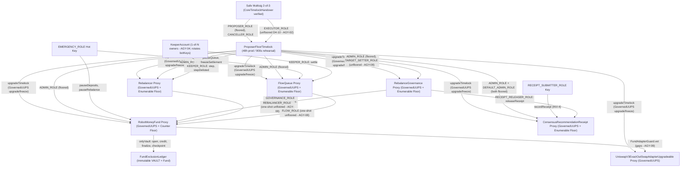

# 01 — Governance and Access Control

**Base:** `dev` (`6c25fd8ce291a88ed088f71e0e015296a561ea24`), merged from `release-0.9.0` (`86747f24534a39cf19a75d4370d3f91466dcc24f`, tag `contracts-0.9.0`) via PR `#2019` (`contracts/` tree is byte-identical across both commits)
**Review Date:** `2026-11-21T21:47:00Z` · **Reviewer:** Antigravity (`agy`)

This chapter audits the governance, role hierarchy, operational account controls, adapter vetting rules, and proxy upgradeability boundaries of the `v0.9.0` One-Vault Fund System. It covers findings **AGY-02 [HIGH]**, **AGY-04 [MEDIUM]**, **AGY-08 [MEDIUM]**, and **AGY-09 [LOW]**, together with a full verification of `ConsensusRecommendationReceipt`, `RebalanceGovernance`, and `GovernedUUPS`.

---

## 1. Governance & Role Topology

The Fund System deploys six ERC-1967 proxies (`GovernedUUPS`) governed by a dedicated `ProposerFloorTimelock` (`48 hours` production floor in `CoreTimelockHandover.MIN_PRODUCTION_DELAY = 172_800`, `900s` in Deploy 4 rehearsal) controlled by a 2-of-3 Gnosis Safe (`SAFE_THRESHOLD >= 2`, `SAFE_OWNERS.length >= 2`), alongside a non-upgradeable `KeeperAccount` and `FundExclusionLedger`. Under owner decision `D4-10` (`FundTimelockPolicy.sol`), the Fund System departs from the Vaults System's open executor (`ADR-0004`): the Safe is the sole `PROPOSER_ROLE`, `CANCELLER_ROLE`, and `EXECUTOR_ROLE` holder on `ProposerFloorTimelock`.



### Role & Authority Matrix

| Contract | Role / Authority | Post-Handover Holder | Role Admin | Last-Holder Floor? | Re-grant / Recovery if Lost? | Gated Powers |
|---|---|---|---|---|---|---|
| `ProposerFloorTimelock` | `DEFAULT_ADMIN_ROLE` | `address(this)` (self) | `DEFAULT_ADMIN_ROLE` | N/A (self) | N/A | Administers timelock roles via executed ops |
| `ProposerFloorTimelock` | `PROPOSER_ROLE` | `Safe` (2-of-3) | `DEFAULT_ADMIN_ROLE` | **Yes** (`proposerCount >= 1`, `LastProposerFloor`) | Timelock self-call | `schedule`, `scheduleBatch` |
| `ProposerFloorTimelock` | `CANCELLER_ROLE` | `Safe` (2-of-3) | `DEFAULT_ADMIN_ROLE` | No | Re-grantable via `PROPOSER` + `EXECUTOR` | `cancel` |
| `ProposerFloorTimelock` | `EXECUTOR_ROLE` | `Safe` (2-of-3, `D4-10`) | `DEFAULT_ADMIN_ROLE` | **No (AGY-02)** | **None if count = 0** (requires `execute`) | `execute`, `executeBatch` across all 6 proxies |
| `RobotMoneyFund` | `ADMIN_ROLE` | `Timelock` | `ADMIN_ROLE` (self) | **Yes** (`adminCount >= 1`, `AdminFloorAccessControlCounter`) | Cannot hit 0 | Assets, caps, fees, adapter hashes, `shutdown`, `restore`, `emergencyUnwind`, `delistAsset`, `closePlan`, `resumePlan`, `extendBudget` |
| `RobotMoneyFund` | `EMERGENCY_ROLE` | Hot key | `ADMIN_ROLE` | No | `ADMIN_ROLE` grants new holder | `pauseDeposits`, `pauseRebalance` (pause-only) |
| `RobotMoneyFund` | `GOVERNANCE_ROLE` | `RebalanceGovernance` | `GOVERNANCE_ROLE` (self) | **No (AGY-08)** | **None** (`RolesAlreadyBound` blocks rebind) | `setTargetAndOpenPlan` |
| `RobotMoneyFund` | `REBALANCER_ROLE` | `Rebalancer` | `REBALANCER_ROLE` (self) | **No (AGY-08)** | **None** (`RolesAlreadyBound` blocks rebind) | `executeStep`, `executeDelistStep`, `concludePlan` |
| `RobotMoneyFund` | `FLOW_ROLE` | `FlowQueue` | `FLOW_ROLE` (self) | **No (AGY-08)** | **None** (`FlowRoleAlreadyBound` blocks rebind) | `mintInKind`, `sellForFlow*`, `ledgerCheckpoint` |
| `FlowQueue` | `ADMIN_ROLE` | `Timelock` | `ADMIN_ROLE` (self) | **Yes** (`AdminFloorAccessControl`) | Cannot hit 0 | `setFlowParams`, `setFlowLevers`, `unpauseQueue`, `releaseSettlement`, grants |
| `FlowQueue` | `EMERGENCY_ROLE` | Hot key | `ADMIN_ROLE` | No | `ADMIN_ROLE` grants new holder | `pauseQueue`, `freezeSettlement` |
| `FlowQueue` | `KEEPER_ROLE` | `KeeperAccount` | `ADMIN_ROLE` | No | `ADMIN_ROLE` grants new holder | `settle` (`D20`/`E34` exclusive) |
| `Rebalancer` | `ADMIN_ROLE` | `Timelock` | `ADMIN_ROLE` (self) | **Yes** (`AdminFloorAccessControl`) | Cannot hit 0 | `setStepParams`, `setAssetStepParams`, `setStepDepthBps`, grants |
| `Rebalancer` | `KEEPER_ROLE` | `KeeperAccount` | `ADMIN_ROLE` | No | `ADMIN_ROLE` grants new holder | `step`, `stepDelisted` (`D20`/`E34` exclusive) |
| `RebalanceGovernance` | `ADMIN_ROLE` | `Timelock` | `ADMIN_ROLE` (self) | **Yes** (`AdminFloorAccessControl`) | Cannot hit 0 | `setTarget`, `setDefaultPlanParams` |
| `RebalanceGovernance` | `TARGET_SETTER_ROLE` | `Timelock` | `TARGET_SETTER_ROLE` (self) | **No (AGY-08)** | **None unless upgraded** (bricked if frozen) | `applyReceipt` |
| `ConsensusRecommendationReceipt` | `DEFAULT_ADMIN_ROLE` | `Timelock` | `DEFAULT_ADMIN_ROLE` | **Yes** (`_revokeRole` override) | Cannot hit 0 | Administers `ADMIN_ROLE` |
| `ConsensusRecommendationReceipt` | `ADMIN_ROLE` | `Timelock` | `DEFAULT_ADMIN_ROLE` | **Yes** (`AdminFloorAccessControl`) | Cannot hit 0 | Administers `RECEIPT_SUBMITTER_ROLE`, `RECEIPT_RELEASER_ROLE` |
| `ConsensusRecommendationReceipt` | `RECEIPT_SUBMITTER_ROLE` | Submitter key | `ADMIN_ROLE` | No | `ADMIN_ROLE` grants new holder | `recordReceipt` |
| `ConsensusRecommendationReceipt` | `RECEIPT_RELEASER_ROLE` | `RebalanceGovernance` | `ADMIN_ROLE` | No | `ADMIN_ROLE` grants new holder | `releaseReceipt` |
| All 6 ERC-1967 Proxies | `upgradeTimelock` | `Timelock` | Immutable (ERC-7201) | Immutable | One-way `freezeUpgrades` | `upgradeToAndCall`, `freezeUpgrades` |
| `KeeperAccount` | `_owners` | Operator key(s) | `_owners` (1-of-N) | Partial (`LastOwner`, **no quorum — AGY-04**) | `ADMIN_ROLE` must replace `KEEPER_ROLE` (48h) | `addOwner`, `removeOwner`, `addBotKey`, `removeBotKey`, `execute` |

---

## 2. Detailed Governance & Access-Control Findings

### AGY-02 [HIGH] — `ProposerFloorTimelock` lacks an `EXECUTOR_ROLE` floor under `D4-10` closed-executor policy

- **Severity:** High
- **Category:** Governance Bricking / Access Control (`ACL-3` violation)
- **Locations:**
  - `contracts/ProposerFloorTimelock.sol:38-85`
  - `contracts/script/FundTimelockPolicy.sol:13-19`
  - `contracts/script/DeployFundTimelock.s.sol:41-48,145-153`
  - `lib/openzeppelin-contracts/contracts/governance/TimelockController.sol:131-133,145-150,364,391`
  - `contracts/lib/GovernedUUPS.sol:154-158`

#### Description & Verified Code

`ProposerFloorTimelock` wraps OpenZeppelin `TimelockController` to prevent the Safe from dropping the last `PROPOSER_ROLE` holder via `revokeRole` or `renounceRole`:

```solidity
// contracts/ProposerFloorTimelock.sol:67-84
function _grantRole(bytes32 role, address account) internal virtual override returns (bool) {
    bool granted = super._grantRole(role, account);
    if (granted && role == PROPOSER_ROLE) proposerCount++;
    return granted;
}

function _revokeRole(bytes32 role, address account) internal virtual override returns (bool) {
    if (role == PROPOSER_ROLE && proposerCount == 1 && hasRole(role, account)) {
        revert LastProposerFloor();
    }
    bool revoked = super._revokeRole(role, account);
    if (revoked && role == PROPOSER_ROLE) proposerCount--;
    return revoked;
}
```

When `ProposerFloorTimelock` was designed under `ADR-0004`, `EXECUTOR_ROLE` was granted to `address(0)` (open executor), so no single account could renounce open execution. However, on `2026-11-13` (decision `D4-10`, `contracts/script/FundTimelockPolicy.sol:13-19`), the Fund System switched to a closed **Safe-only executor** (`executors = [safe]`, verified at `DeployFundTimelock.s.sol:146-153` with `hasRole(EXECUTOR_ROLE, safe) == true` and `hasRole(EXECUTOR_ROLE, address(0)) == false`).

In OpenZeppelin `TimelockController` (`lib/openzeppelin-contracts/contracts/governance/TimelockController.sol:145-150,364,391`), both `execute` and `executeBatch` enforce:

```solidity
modifier onlyRoleOrOpenRole(bytes32 role) {
    if (!hasRole(role, address(0))) {
        _checkRole(role, _msgSender());
    }
    _;
}
```

Meanwhile, `DEFAULT_ADMIN_ROLE` on `ProposerFloorTimelock` is held solely by `address(this)` (`admin = address(0)` passed to `TimelockController`, `UpgradeAuthority.sol:64`). Because `ProposerFloorTimelock._revokeRole` only floors `PROPOSER_ROLE`:

1. **Instant zero-delay brick via `renounceRole`:** OpenZeppelin `AccessControl.renounceRole(EXECUTOR_ROLE, safe)` can be called directly by the `Safe` in a **single Safe transaction with zero timelock delay**, bypassing `DEFAULT_ADMIN_ROLE` and bypassing `PROPOSER_ROLE`'s `LastProposerFloor`.
2. **Delayed brick via `revokeRole`:** A scheduled `timelock.revokeRole(EXECUTOR_ROLE, safe)` (e.g., an aborted or misordered executor rotation that forgets to grant the new executor first) executes through `DEFAULT_ADMIN_ROLE` and leaves zero `EXECUTOR_ROLE` holders.

Note that the earlier cross-review addendum (`docs/code-reviews/20261117-163636-testmachine/04-cross-review-addendum.md:27-56`) verified only that `DeployFundTimelock._check` and `publish-contracts/src/verify/fund.ts` read back initial `EXECUTOR_ROLE` state at deploy time without CI enforcement; neither checked that `ProposerFloorTimelock` lacks a runtime `EXECUTOR_ROLE` floor against dropping to zero holders.

#### Attack / Failure Scenario

1. During an executor handover (e.g., rotating to a new Safe or re-enabling open execution) or via a mistaken Safe transaction, the Safe signs `ProposerFloorTimelock.renounceRole(EXECUTOR_ROLE, safe)` before granting `EXECUTOR_ROLE` to any replacement address (or `address(0)`).
2. The transaction executes **immediately** (no 48-hour timelock delay, no `CANCELLER_ROLE` veto window).
3. `hasRole(EXECUTOR_ROLE, address(0))` is `false` and `hasRole(EXECUTOR_ROLE, account)` is `false` for every address on-chain.
4. Any subsequent proposal scheduled by the Safe (even though `PROPOSER_ROLE` stays intact!) can never be executed (`AccessControlUnauthorizedAccount(caller, EXECUTOR_ROLE)`), and `DEFAULT_ADMIN_ROLE` is locked inside the timelock itself.

#### Impact Analysis

- **Permanent Protocol-Wide Governance Brick (`ACL-3` Violation):** Every `ADMIN_ROLE` function across `RobotMoneyFund`, `FlowQueue`, `Rebalancer`, `RebalanceGovernance`, and `ConsensusRecommendationReceipt`, plus `upgradeToAndCall` and `freezeUpgrades` across all **6 ERC-1967 proxies**, becomes permanently unreachable.
- **Permanent Fund Freeze During Incidents:** Under Step 3f (`RobotMoneyFund.sol:221-222`), `redeemInKind` reverts `InKindClosed` unless `shutdown == true`, and `shutdown()` is `ADMIN_ROLE`-gated (`RobotMoneyFund.sol:864-866`). If `FlowQueue.settle()` is ever stalled (e.g., dead oracle feed or stopped keeper), users cannot even exit via `redeemInKind` because governance can never execute `shutdown()`.

#### Concrete Solidity Remediation

Track `executorCount` inside `ProposerFloorTimelock.sol` symmetrically with `proposerCount`, reverting `NoExecutor()` in the constructor and `LastExecutorFloor()` in `_revokeRole` whenever the final `EXECUTOR_ROLE` holder (including `address(0)` in the Vaults System's open-executor configuration) would be removed:

```solidity
// contracts/ProposerFloorTimelock.sol (recommended patch)
contract ProposerFloorTimelock is TimelockController {
    uint256 public proposerCount;
    /// @notice Number of accounts currently holding `EXECUTOR_ROLE` (includes `address(0)` when open).
    uint256 public executorCount;

    error LastProposerFloor();
    error LastExecutorFloor();
    error NoProposer();
    error NoExecutor();

    constructor(
        uint256 minDelay,
        address[] memory proposers,
        address[] memory executors,
        address admin
    ) TimelockController(minDelay, proposers, executors, admin) {
        if (proposerCount == 0) revert NoProposer();
        if (executorCount == 0) revert NoExecutor();
    }

    function _grantRole(bytes32 role, address account) internal virtual override returns (bool) {
        bool granted = super._grantRole(role, account);
        if (granted) {
            if (role == PROPOSER_ROLE) proposerCount++;
            else if (role == EXECUTOR_ROLE) executorCount++;
        }
        return granted;
    }

    function _revokeRole(bytes32 role, address account) internal virtual override returns (bool) {
        if (hasRole(role, account)) {
            if (role == PROPOSER_ROLE && proposerCount == 1) revert LastProposerFloor();
            if (role == EXECUTOR_ROLE && executorCount == 1) revert LastExecutorFloor();
        }
        bool revoked = super._revokeRole(role, account);
        if (revoked) {
            if (role == PROPOSER_ROLE) proposerCount--;
            else if (role == EXECUTOR_ROLE) executorCount--;
        }
        return revoked;
    }
}
```

*Deployment note:* Because `ProposerFloorTimelock` is deployed via CREATE2 (`UpgradeAuthority.timelockInitCode`), updating its bytecode changes the predicted CREATE2 address for new deployments and requires a fresh timelock deployment + role handover (`upgradeTimelock` is immutable in ERC-7201 storage, so existing rehearsal proxies remain bound to the deployed Deploy 4 timelock unless redeployed). Also wire `DeployFundTimelock._check` / `verify/fund.ts` into PR CI (`04-cross-review-addendum.md:154-159`).

---

### AGY-04 [MEDIUM] — `KeeperAccount` uses 1-of-N owner authority without quorum

- **Severity:** Medium
- **Category:** Governance / Privilege Escalation & Keeper DoS
- **Locations:**
  - `contracts/KeeperAccount.sol:37-111`
  - `contracts/script/DeployKeeperAccount.s.sol:25-61`
  - `contracts/FlowQueue.sol:191-193` (`FlowCheckLib.sol:118`)
  - `contracts/Rebalancer.sol:234-238,262-267`
  - `docs/technical/one-vault-rebalancer-proposal.md:524,1137-1144,1421-1425,1459` (`D20`, `D36`)
  - `docs/technical/one-vault-timed-flows-eng-plan.md:408,430` (`E34`, `E56`)

#### Description & Verified Code

Under Step 3f decisions `D20` / `E34`, `keeperGrace` was removed from both `FlowQueue.settle` and `Rebalancer.step` (`Rebalancer.permissionlessAt()` returns `type(uint256).max`), leaving a **single** `KEEPER_ROLE` holder — `KeeperAccount` (`D36`, `E56`) — responsible for all settlement and rebalance progression.

However, `KeeperAccount` implements **1-of-N** owner permissions with no quorum or threshold:

```solidity
// contracts/KeeperAccount.sol:52-55,77-98
modifier onlyOwner() {
    if (!_isOwner[msg.sender]) revert NotOwner();
    _;
}
...
function addBotKey(address key) external onlyOwner {
    _addBotKey(key);
}

function removeBotKey(address key) external onlyOwner {
    if (!_isBotKey[key]) revert InvalidAccount();
    _isBotKey[key] = false;
    _remove(_botKeys, key);
    emit BotKeyRemoved(key);
}

function addOwner(address who) external onlyOwner {
    _addOwner(who);
}

function removeOwner(address who) external onlyOwner {
    if (!_isOwner[who]) revert InvalidAccount();
    if (_owners.length == 1) revert LastOwner();
    _isOwner[who] = false;
    _remove(_owners, who);
    emit OwnerRemoved(who);
}
```

Meanwhile, `DeployKeeperAccount.s.sol` reads `KEEPER_OWNERS` (`address[]`) and deploys `KeeperAccount` without requiring either a Safe multisig owner or an M-of-N owner threshold (unlike `CoreTimelockHandover._requireRealSafe`, which strictly enforces `threshold >= 2` and `owners.length >= 2`).

#### Attack / Failure Scenario

1. Suppose `KEEPER_OWNERS` lists multiple team EOAs (e.g., the 3 Safe owner keys `[O1, O2, O3]`).
2. An attacker compromises **just 1-of-3** owner key `O1` (which is insufficient to pass the 2-of-3 Safe threshold).
3. In a single transaction, `O1` calls:
   - `keeperAccount.addOwner(attacker)`
   - `keeperAccount.removeOwner(O1)`
   - `keeperAccount.removeOwner(O2)`
   - `keeperAccount.removeOwner(O3)`
   - `keeperAccount.removeBotKey(bot1)`
4. `_owners.length == 1` (`LastOwner`) never triggers because `attacker` was added first. The remaining owners are permanently locked out of `KeeperAccount`, and `KeeperAccount.execute` accepts calls from `attacker` (as sole owner) while rejecting the team's bot keys.
5. Even without malice, a single compromised or rogue owner key can unilaterally remove all bot keys or halt calls.

#### Impact Analysis

- **48-Hour Protocol Liveness Freeze:** Because `KEEPER_ROLE` on `FlowQueue` and `Rebalancer` is administered solely by `ADMIN_ROLE` (`TimelockController`), recovering from a hijacked `KeeperAccount` requires a 2-of-3 Safe schedule, a full `48-hour` production timelock delay, and a 2-of-3 Safe execute (`grantRole` + `revokeRole`). During those 48+ hours, **zero deposits or redemptions can settle and zero rebalance or delist steps can run**.
- **Selective Timing Manipulation Window:** While holding `KeeperAccount`, the attacker controls `settle` and `step` execution timing within the protocol's oracle/TWAP bands (`AGY-06`) and can trigger `StepInWindow` conflicts (`E42`) by submitting `step()` calls on basket legs right before settlement windows.

#### Concrete Solidity Remediation

Two complementary options eliminate 1-of-N key risk while preserving `D36`'s zero-timelock bot-key rotation:

1. **Contract-level M-of-N threshold inside `KeeperAccount.sol` (Recommended):** Require at least `threshold` distinct owner ECDSA/EIP-1271 approvals (with replay-protected `nonce`) for `addOwner`, `removeOwner`, `setThreshold`, and `addBotKey`/`removeBotKey`, and enforce `threshold >= 2` when `initialOwners.length >= 2` (or require a smart-contract multisig owner in `DeployKeeperAccount.s.sol` via `owners.length == 1 && owners[0].code.length > 0`).

```solidity
// contracts/KeeperAccount.sol (thresholded owner-action pattern preserving D36/E56)
import {ECDSA} from "@openzeppelin/contracts/utils/cryptography/ECDSA.sol";
import {EIP712} from "@openzeppelin/contracts/utils/cryptography/EIP712.sol";

contract KeeperAccount is EIP712 {
    bytes32 public constant ADMIN_CALL_TYPEHASH =
        keccak256("AdminCall(bytes data,uint256 nonce,uint256 deadline)");

    uint256 public threshold;
    uint256 public nonce;

    error InvalidThreshold();
    error ExpiredSignature();
    error DuplicateOrInvalidSigner();

    /// @notice Execute an owner governance call (addOwner/removeOwner/addBotKey/removeBotKey/setThreshold)
    ///         only when `threshold` strictly-increasing distinct owners sign the EIP-712 digest.
    function execOwnerCall(bytes calldata data, uint256 deadline, bytes[] calldata sigs)
        external
    {
        if (block.timestamp > deadline) revert ExpiredSignature();
        if (sigs.length < threshold) revert InvalidThreshold();
        bytes32 digest = _hashTypedDataV4(
            keccak256(abi.encode(ADMIN_CALL_TYPEHASH, keccak256(data), nonce++, deadline))
        );
        address lastSigner;
        for (uint256 i; i < threshold; ++i) {
            address signer = ECDSA.recover(digest, sigs[i]);
            if (!_isOwner[signer] || signer <= lastSigner) revert DuplicateOrInvalidSigner();
            lastSigner = signer;
        }
        (bool ok, bytes memory ret) = address(this).call(data);
        if (!ok) revert CallFailed(ret);
    }
}
```
*(In that design, `addOwner`, `removeOwner`, `addBotKey`, `removeBotKey`, and `setThreshold` require `msg.sender == address(this)` instead of 1-of-N `onlyOwner`, and `execute` should likewise be restricted to `_isBotKey[msg.sender]` or `msg.sender == address(this)` so a single owner EOA cannot bypass bot-key isolation; `DeployKeeperAccount.s.sol` retains `owners()` and `botKeys()` views untouched for the verifier.)*

2. **Immediate Operational Mitigation (No Solidity Change):** Deploy `KeeperAccount` with `KEEPER_OWNERS` set solely to a dedicated 2-of-3 Gnosis Safe (`threshold >= 2`) rather than individual EOAs, and verify `owners.length == 1 && owners[0].code.length > 0` in `DeployKeeperAccount.s.sol`.

---

### AGY-08 [MEDIUM] — Self-administered roles bypass `AdminFloorAccessControl` with no recovery path

- **Severity:** Medium
- **Category:** Governance Bricking / Role Administration
- **Locations:**
  - `contracts/RebalanceGovernance.sol:61-65,120-124`
  - `contracts/RobotMoneyFund.sol:73-78,110-116,284-292,518-530`
  - `contracts/lib/AdminFloorAccessControl.sol:41,50-55`
  - `contracts/lib/AdminFloorAccessControlCounter.sol:51,73-80`

#### Description & Verified Code

`AdminFloorAccessControl` (`RebalanceGovernance`, `FlowQueue`, `Rebalancer`, `ConsensusRecommendationReceipt`) and `AdminFloorAccessControlCounter` (`RobotMoneyFund`) hardcode a floor only for `FLOOR_ADMIN_ROLE = keccak256("ADMIN_ROLE")` (plus an explicit `DEFAULT_ADMIN_ROLE` floor in `ConsensusRecommendationReceipt._revokeRole`):

```solidity
// contracts/lib/AdminFloorAccessControl.sol:41,50-55
bytes32 internal constant FLOOR_ADMIN_ROLE = keccak256("ADMIN_ROLE");

function _revokeRole(bytes32 role, address account) internal virtual override returns (bool) {
    if (role == FLOOR_ADMIN_ROLE && hasRole(role, account) && getRoleMemberCount(role) == 1) {
        revert LastAdminFloor();
    }
    return super._revokeRole(role, account);
}
```

Four critical self-administered roles across `RebalanceGovernance` and `RobotMoneyFund` are **not** covered by this floor and have **no** `ADMIN_ROLE` fallback:

1. **`TARGET_SETTER_ROLE` on `RebalanceGovernance`** (`contracts/RebalanceGovernance.sol:120-123`):
```solidity
_setRoleAdmin(ADMIN_ROLE, ADMIN_ROLE);
_grantRole(ADMIN_ROLE, admin_);
_setRoleAdmin(TARGET_SETTER_ROLE, TARGET_SETTER_ROLE);
_grantRole(TARGET_SETTER_ROLE, admin_);
```
2. **`GOVERNANCE_ROLE`, `REBALANCER_ROLE`, and `FLOW_ROLE` on `RobotMoneyFund`** (`contracts/RobotMoneyFund.sol:110-114,284-292,518-530`):
```solidity
_setRoleAdmin(ADMIN_ROLE, ADMIN_ROLE);
_setRoleAdmin(EMERGENCY_ROLE, ADMIN_ROLE);
_setRoleAdmin(GOVERNANCE_ROLE, GOVERNANCE_ROLE);
_setRoleAdmin(REBALANCER_ROLE, REBALANCER_ROLE);
_setRoleAdmin(FLOW_ROLE, FLOW_ROLE);
```
`bindRebalanceRoles` (`if (s.rolesBound) revert RolesAlreadyBound();`) and `bindFlowRole` (`if (s.flowRoleBound) revert FlowRoleAlreadyBound();`) are strict one-shot setters.

#### Attack / Failure Scenario

- **Scenario A (`TARGET_SETTER_ROLE` brick):** During a `Timelock` role migration or an aborted rotation, the `TimelockController` revokes or renounces its own `TARGET_SETTER_ROLE` on `RebalanceGovernance` (`renounceRole(TARGET_SETTER_ROLE, timelock)` or `revokeRole(TARGET_SETTER_ROLE, timelock)`). Because `TARGET_SETTER_ROLE` is self-administered (`_setRoleAdmin(TARGET_SETTER_ROLE, TARGET_SETTER_ROLE)`), `ADMIN_ROLE` cannot re-grant it. If `RebalanceGovernance` has been frozen via `GovernedUUPS.freezeUpgrades` (required by `docs/prd.md:416-419` after a proving period), `applyReceipt()` is **permanently bricked**.
- **Scenario B (`GOVERNANCE_ROLE` / `REBALANCER_ROLE` / `FLOW_ROLE` dead-end):** If `RebalanceGovernance`, `Rebalancer`, or `FlowQueue` is upgraded (or frozen via `FrozenAtDeploy` / `freezeUpgrades`) and a migration or replacement contract is later required, or if a buggy upgrade calls `renounceRole` on `RobotMoneyFund`, `ADMIN_ROLE` cannot revoke or reassign any of those three roles (`RolesAlreadyBound` / `FlowRoleAlreadyBound`). Even if `RobotMoneyFund` remains upgradeable, upgrading it solely to recover from a frozen companion proxy requires an unscheduled core-vault upgrade.

#### Impact Analysis

- Losing `TARGET_SETTER_ROLE` permanently disables consensus-receipt execution (`applyReceipt`), forcing all future portfolio changes onto receipt-less `setTarget` (violating `PRD §2` / `§9` IC receipt integration).
- Losing `FLOW_ROLE` permanently halts `mintInKind`, `sellForFlow*`, and `ledgerCheckpoint`; losing `REBALANCER_ROLE` halts all rebalancing and delisting steps; losing `GOVERNANCE_ROLE` halts opening new plans. Once proxies are frozen per `contract-upgradeability-plan.md`, all three are permanent.

#### Concrete Solidity Remediation

1. **Floor `TARGET_SETTER_ROLE` on `RebalanceGovernance`:** Override `_revokeRole` in `RebalanceGovernance.sol` to enforce a last-holder floor on `TARGET_SETTER_ROLE` just as `ConsensusRecommendationReceipt.sol:145-150` does for `DEFAULT_ADMIN_ROLE`:

```solidity
// contracts/RebalanceGovernance.sol (recommended addition)
error LastTargetSetterFloor();

function _revokeRole(bytes32 role, address account) internal virtual override returns (bool) {
    if (role == TARGET_SETTER_ROLE && hasRole(role, account) && getRoleMemberCount(role) == 1) {
        revert LastTargetSetterFloor();
    }
    return super._revokeRole(role, account);
}
```

2. **Floor and/or add timelock recovery for `GOVERNANCE_ROLE`, `REBALANCER_ROLE`, and `FLOW_ROLE` in `RobotMoneyFund`:**
   - First, prevent accidental renunciation/zeroing of those three roles by rejecting revocations (or tracking a simple `uint256` bitmask / counter in `FundAdminLib` if EIP-170 space in `RobotMoneyFund` is tight — `v0.9.0-in-place-upgrade-audit.md:152` notes ~382 bytes headroom).
   - Second, if replacing a frozen companion proxy (`FlowQueue`, `Rebalancer`, `RebalanceGovernance`) should remain possible while `RobotMoneyFund` is upgradeable or paused/shut down, gate `rebindFlowRole` / `rebindRebalanceRoles` behind `ADMIN_ROLE` (the 48h Safe+Timelock, never an EOA) rather than irreversible one-shot booleans — or retain `RB-1`/`E1` immutability only once all proxies are frozen together (`freezeUpgrades`).

---

### AGY-09 [LOW] — `FundAdapterGuard.vet` omits `codeHashAllowed` on direct adapters and is bypassed in `StepFeedLib` / `FlowCheckLib`

- **Severity:** Low
- **Category:** Governance / Adapter Vetting (`ADR-0019`)
- **Locations:**
  - `contracts/lib/FundAdapterGuard.sol:20-46`
  - `contracts/lib/StepFeedLib.sol:145-160`
  - `contracts/lib/FlowCheckLib.sol:588-605`
  - `contracts/RobotMoneyFund.sol:757-766`
  - `docs/adr/ADR-0019-fund-swap-adapters-governed-uups-proxies.md:22-25`

#### Description & Verified Code

`ADR-0019` Decision 3 specifies that the Fund System vets basket swap adapters on **every use**:
> *"The check runs on every use of a basket swap adapter: admission (`addAsset`), the adapter swap (`setAssetAdapter`), every swap, every TWAP price read, and the fixed-fee check (E43). A failed check reverts `AdapterCodeHashNotAllowed(adapter, hash)`."* (`docs/adr/ADR-0019-fund-swap-adapters-governed-uups-proxies.md:24`)

Three code gaps break this invariant:

1. **`FundAdapterGuard.vet` returns early without checking `s.codeHashAllowed[h]` when `!s.adapterProxyCodeHash[h]`** (`contracts/lib/FundAdapterGuard.sol:27-37`):
```solidity
function vet(FundState storage s, address adapter) internal view returns (address) {
    bytes32 h = adapter.codehash;
    if (!s.adapterProxyCodeHash[h]) return adapter;
    if (!s.codeHashAllowed[h]) revert IRobotMoneyFund.AdapterCodeHashNotAllowed(adapter, h);
    address impl = IAdapterImplementation(adapter).implementation();
    bytes32 ih = impl.codehash;
    if (!s.codeHashAllowed[ih] || s.adapterProxyCodeHash[ih]) {
        revert IRobotMoneyFund.AdapterCodeHashNotAllowed(impl, ih);
    }
    return adapter;
}
```
Notice `requireAdmissible` (`:41-45`) checks `s.codeHashAllowed[h]` before calling `vet`, but `vet` itself skips `s.codeHashAllowed[h]` whenever `s.adapterProxyCodeHash[h]` is `false`. Consequently:
   - Calling `RobotMoneyFund.setAdapterCodeHashAllowed(directAdapterHash, false)` (`RobotMoneyFund.sol:757-766`) **does not stop** swaps or TWAP reads on an active direct-deployment basket adapter!
   - If governance calls `setAdapterProxyCodeHash(proxyHash, false)` (`FundAdminLib.sol:654-659`) before swapping out an asset's adapter, `vet` immediately stops verifying `implementation()` and permits unapproved implementations!

2. **`StepFeedLib._twap` bypasses `FundAdapterGuard.vet`** (`contracts/lib/StepFeedLib.sol:147-160`):
```solidity
function _twap(AssetConfig memory a, address usdc, uint256 unit)
    private
    view
    returns (bool ok, uint256 v)
{
    try IBasketSwapAdapter(a.adapter)
        .twapPrice(a.pool, a.token, usdc, unit, a.twapWindow) returns (
        uint256 q
    ) {
        return (true, q);
    } catch {
        return (false, 0);
    }
}
```
`StepFeedLib.check` is called by `Rebalancer.step()` and by `FundStepLib._stepFeeds` (`executeStep`) without vetting `a.adapter`.

3. **`FlowCheckLib._requireFundedPoolsFixedFee` bypasses `FundAdapterGuard.vet`** (`contracts/lib/FlowCheckLib.sol:590-604`):
```solidity
function _requireFundedPoolsFixedFee(IRobotMoneyFundFull f) private view {
    AssetConfig[] memory cfgs = f.assetConfigs();
    uint16[] memory targets = f.targetBps();
    for (uint256 i; i < cfgs.length; ++i) {
        if (!cfgs[i].active || cfgs[i].kind != AssetKind.Basket) continue;
        if (i >= targets.length || targets[i] == 0) continue;
        bool fixedFee;
        try IExactOutSwapAdapter(cfgs[i].adapter).isFixedFeePool(cfgs[i].pool) returns (
            bool b
        ) {
            fixedFee = b;
        } catch {}
        if (!fixedFee) revert IFlowEvents.FlowParamOutOfBounds(14);
    }
}
```

#### Failure Scenario & Impact

- **Failure to emergency-halt a compromised direct swap adapter:** If a non-proxy swap adapter has a critical bug and governance revokes its code hash via `setAdapterCodeHashAllowed(h, false)` expecting immediate cessation across all operations (as happens for lending adapters), basket swaps (`_swap`), `mintInKind` (`_buyExact`), and `FundValuationLib.assetValue` / `usdcValue` / `tokenValue` continue executing against the revoked adapter until `setAssetAdapter` or `delistAsset` runs.
- **Unvetted proxy implementations in `StepFeedLib` & `FlowCheckLib`:** If an adapter proxy points to a disallowed implementation, `StepFeedLib._twap` and `FlowQueue.setFlowParams` still consume `twapPrice` / `isFixedFeePool` from the unvetted implementation (`executeStep` only catches it later if a swap runs; lending-to-lending steps or `Rebalancer.step()` Check 4 reads and `setFlowParams` validation never hit `vet` at all).

#### Concrete Solidity Remediation

1. **Always check `s.codeHashAllowed[h]` in `FundAdapterGuard.vet`:**
```solidity
// contracts/lib/FundAdapterGuard.sol (recommended patch)
function vet(FundState storage s, address adapter) internal view returns (address) {
    bytes32 h = adapter.codehash;
    if (!s.codeHashAllowed[h]) revert IRobotMoneyFund.AdapterCodeHashNotAllowed(adapter, h);
    if (!s.adapterProxyCodeHash[h]) return adapter;
    address impl = IAdapterImplementation(adapter).implementation();
    bytes32 ih = impl.codehash;
    if (!s.codeHashAllowed[ih] || s.adapterProxyCodeHash[ih]) {
        revert IRobotMoneyFund.AdapterCodeHashNotAllowed(impl, ih);
    }
    return adapter;
}
```
*(With `vet` enforcing `s.codeHashAllowed[h]`, `requireAdmissible` simplifies cleanly to `vet(s, adapter);`.)*

2. **Expose a single vetted-adapter check / TWAP helper on `RobotMoneyFund` (via `FundValuationLib` to protect EIP-170 headroom) and enforce it in `StepFeedLib` and `FlowCheckLib`:**
   - Have `StepFeedLib` read the asset's TWAP via `IRobotMoneyFund(fund).assetUsdcValue(i, unit)` (which calls `FundValuationLib.usdcValue` -> `FundAdapterGuard.vet(s, a.adapter)`!) or a read-only `isAdapterVetted(address)` view backed by `FundValuationLib.viewUint`.
   - Have `FlowCheckLib._requireFundedPoolsFixedFee(f)` verify `f.adapterCodeHashAllowed(adapter.codehash)` and proxy implementation status (via `f.isAdapterVetted(cfgs[i].adapter)`) before trusting `isFixedFeePool`.

---

## 3. Verified Governance Components

### 3.1 `ConsensusRecommendationReceipt` (`contracts/ConsensusRecommendationReceipt.sol`)

Verified against `INV-3`, `INV-4`, and `RS-1019-14`:

- **Signalling-only boundary (`INV-4`, `:244-253`):** Contains no `receive()`, no `fallback()`, no ERC-20 transfer surface, and makes zero outbound calls to `RobotMoneyFund`, `Rebalancer`, `FlowQueue`, or `RebalanceGovernance`.
- **Two-role floor (`:145-150`):** Inherits `AdminFloorAccessControl` (flooring `ADMIN_ROLE`) and explicitly overrides `_revokeRole` to floor `DEFAULT_ADMIN_ROLE` (`LastAdminFloor`), closing the gap where `DEFAULT_ADMIN_ROLE` administers `ADMIN_ROLE` (`:120-123`).
- **One-shot submission & release (`:155-202`):** `recordReceipt` (`RECEIPT_SUBMITTER_ROLE`) rejects zero `receiptId`, zero `payloadDigest`, empty `payloadUri`, and duplicate `receiptId` (`ReceiptAlreadyRecorded`); `releaseReceipt` (`RECEIPT_RELEASER_ROLE`) enforces one-shot `if (r.released) revert ReceiptAlreadyReleased()`.
- **Migration (`migrateToSubmitterRoles`, `:131-140`):** Gated by `reinitializer(2)` and `msg.sender == GovernedUpgrade.layout().upgradeTimelock`, granting `RECEIPT_RELEASER_ROLE` to `RebalanceGovernance` and stripping any legacy `ADMIN_ROLE` (`RS-1019-14`).
- **Known operational edge case (accepted/documented):** Same-second `recordReceipt` calls share `recordedAt = uint64(block.timestamp)` (`:167`); applying one in `RebalanceGovernance` locks out the other under `r.recordedAt <= lastAppliedRecordedAt` (consistent with `20261117-163636-testmachine` finding `#17`).

### 3.2 `RebalanceGovernance` (`contracts/RebalanceGovernance.sol`)

Verified against `RB-1`, `RB-8`, and `RB-9`:

- **Authorization & separation (`:135-184`):** `applyReceipt` requires `TARGET_SETTER_ROLE`; `setTarget` and `setDefaultPlanParams` require `ADMIN_ROLE` (both held by `ProposerFloorTimelock`). Subject to **AGY-08** on `TARGET_SETTER_ROLE`.
- **Digest binding & replay/ordering protection (`:149-161`):** `_checkAndRelease` verifies `isRecorded(receiptId)`, `!r.released`, exact `r.payloadDigest == payloadDigest`, and strict monotonicity `r.recordedAt > lastAppliedRecordedAt` before writing `lastAppliedRecordedAt = r.recordedAt` and calling `receipts.releaseReceipt(receiptId)` (under `nonReentrant`). If `fund.setTargetAndOpenPlan(...)` rejects the vector (`TargetAssetNotActive`, `TargetAssetDuplicate`, `TargetAssetMissing`, `TargetSumInvalid`, `TargetExceedsCap`, `BasketCapExceeded`, `PoolShareExceeded`, `PoolNotFixedFee`, `PoolFeeMarginTooSmall`), the entire transaction reverts cleanly without releasing the receipt or updating `lastAppliedRecordedAt`.
- **Plan parameter bounds (`:203-208`):** `_checkPlanParams` enforces `[MIN_PLAN_DURATION, MAX_PLAN_DURATION]` (`1 days` to `90 days`) and `costBudgetBps` in `[1, MAX_COST_BUDGET_BPS]` (`1` to `500`), re-checked by `FundAdminLib.openPlan`.

### 3.3 `GovernedUUPS` & `GovernedUpgrade` (`contracts/lib/GovernedUUPS.sol`)

Verified across all 6 ERC-1967 proxies (`RobotMoneyFund`, `FlowQueue`, `Rebalancer`, `RebalanceGovernance`, `ConsensusRecommendationReceipt`, `UniswapV3ExactOutSwapAdapterUpgradeable`):

- **Implementation lock (`:196-198`):** Constructor invokes `_disableInitializers()`, preventing direct initialization or takeover of any implementation contract.
- **Anti-delegatecall UUID & active-proxy checks (`:217-220,241-253`):** `proxiableUUID()` requires `address(this) == __self`; `_forwardToGovernedUpgrade()` requires `address(this) != __self && ERC1967Utils.getImplementation() == __self` before forwarding exact calldata via `delegatecall` to `GovernedUpgrade`.
- **Immutable ERC-7201 authority & mandatory release mode (`:78-97`):** `GovernedUpgrade.init` checks `layout().upgradeTimelock == address(0)` (`InvalidInitialization`), rejects `timelock == address(0)` (`InvalidUpgradeTimelock`) and `UpgradeMode.Undeclared` (`UpgradeModeUndeclared`), and atomically enforces `MODE_FROZEN_AT_DEPLOY` (setting `upgradesFrozen = true` and `Initializable.initialized = type(uint64).max`) before any external call can interact with the proxy. There is no setter to rotate `upgradeTimelock`.
- **Target-bound irreversible freeze (`:123-135,154-158`):** `_authorize()` checks `msg.sender == $.upgradeTimelock` and `!$.upgradesFrozen`. `freezeUpgrades(expectedImplementation, expectedCodeHash)` requires both live implementation address and `impl.codehash` to match (`FreezeTargetMismatch`), prevents calling during initialization (`if (_initializable().initializing) revert InvalidInitialization()`), sets `upgradesFrozen = true`, and calls `_disableInitializers()` (`Initializable.initialized = type(uint64).max`) so no future `reinitializer` can ever run.
- **Adapter proxy specifics (`contracts/adapters/UniswapV3ExactOutSwapAdapterUpgradeable.sol:17-30`):** Initializes `GovernedUUPS` in `UpgradeMode.Upgradeable` for `timelock` (`ROUTER` remains an immutable in the implementation contract) and exposes `implementation()` (`ERC1967Utils.getImplementation()`). Per `ADR-0019`, a proxy's reported `implementation()` is trusted only because `upgradeTimelock` is the sole upgrade authority and `FundAdapterGuard` cross-checks both proxy and implementation code hashes (subject to **AGY-09**).
- **`v0.9.0` migration gates (`FundMigrateLib.sol:56-75`, `FlowMigrateLib.sol:105-116`, `Rebalancer.sol:199-202`):** All three `migrateV090` entry points enforce `msg.sender == GovernedUpgrade.layout().upgradeTimelock` and `reinitializer(2)` (implemented directly against `GovernedUpgrade.INITIALIZABLE_STORAGE` in `FundMigrateLib` to save bytecode under `RobotMoneyFund`'s EIP-170 budget).
