# Cross-Cutting Contradictions, Compounding Failure Chains & Unresolved Design Trade-Offs (v0.8.0 / Step 3f)

**Worktree:** `/drive2/home/lucas/tmp/superfield-worktrees/robotmoney-core/design-review-0.8.0`  
**Scope:** Synthesis of design documents and Pass-2-verified domain reviews `01`–`04` (implementation code `.sol`, `.rs`, `.ts` excluded).  
**Primary Sources:**
- `docs/code-reviews/design-review-0.8.0/01-architecture-and-coherence.md` (`ARCH-01`–`ARCH-09`)
- `docs/code-reviews/design-review-0.8.0/02-flows-pricing-and-honesty.md` (`FLOW-01`–`FLOW-10`)
- `docs/code-reviews/design-review-0.8.0/03-rebalancer-economics-and-safety.md` (`SAFE-01`–`SAFE-10`)
- `docs/code-reviews/design-review-0.8.0/04-operations-and-reliability.md` (`OPS-01`–`OPS-08`)
- Verified against `docs/technical/one-vault-rebalancer-proposal.md`, `docs/technical/one-vault-timed-flows-eng-plan.md`, `docs/technical/one-vault-prd-amendments.md`, `docs/technical/one-vault-cost-report.md`, `docs/adr/ADR-0004-agent-token-shortlist-governance.md`, and `docs/code-reviews/0.7.0/*`.

---

## 1. Executive Summary & Systemic Risk Map

Across the four domain reviews (`01`–`04`), **37 finding IDs** (`ARCH-01`–`09`, `FLOW-01`–`10`, `SAFE-01`–`10`, `OPS-01`–`08`) were evaluated and stress-tested through Pass 2 verification against the primary design documents. **Three full findings** (`ARCH-04`, `FLOW-09`, and `SAFE-04`) and several Pass-1 sub-claims (`ARCH-03` `deSPXA`, `SAFE-06` Part 2 reachability, `SAFE-10` Parts 1 & 3, `FLOW-10` band exposure, and `OPS-01` permissionless `keeperGrace` fallback) were **defeated or corrected**, leaving **34 active findings** (`2 Critical`, `10 High`, `14 Medium`, `8 Low` including `SAFE-06` `Low / Medium` and `ARCH-09` `Low / Open Question`) that compound into **six systemic failure chains**:

> **Core Systemic Tension:** Step 3f (`v0.9.0-onevault`) intentionally delegates crisis wind-down and delisting exclusively to Safe + 48h timelock governance (`D18`, `D24`, `D30`, `D4-10`) and settlement/stepping exclusively to a team keeper (`D20`), which the owner explicitly accepted (`§5.11.7 L1270–1274`, `§18.4 L2823–2829`, `§19.2 L2897`). The **genuine systemic failure** occurs where that strict governance boundary meets **broken match-cap conservation (`FLOW-01`, Critical)**, **multi-round lazy `ExclusionLedger` misattribution (`FLOW-02`, Critical)**, **internal operational contradictions** (`D20` multisig vs `DEP-03` single `KEEPER_ROLE` in `OPS-01`; `RUN-01` pool-fee redemption strand in `OPS-04`; `RB-32` `maxPause` cooldown blocking `shutdown` + `pauseDeposits` in `FLOW-03`/`OPS-02`), **asymmetric locked-depositor exposure to impaired lending venues (`SAFE-02`)**, and **underspecified rebalancer–flow coupling & `D23`/`D30` deferred claims (`SAFE-01`, `SAFE-03`, `SAFE-08`, `ARCH-03`, `ARCH-05`)**.

```mermaid
flowchart TD
    A["OPS-01: D20 multisig vs DEP-03 single KEEPER_ROLE + 48h D4-10 rotation"] --> C1["Chain 1: Keeper SPOF, RUN-01 & 48h Liveness Bottlenecks"]
    B["OPS-04 (RUN-01): Fee >= legBandBps stops deposits, strands 100% net redemptions on Check 11"] --> C1
    C["ARCH-05 + OPS-03 + FLOW-05: 48h delisting deadlock, atomic cleanup, 7h net fail"] --> C1

    D["D24 / RB-27: 48h public shutdown notice"] --> C2["Chain 2: Wind-Down Notice Deadlock"]
    E["FLOW-03 / OPS-02: RB-32 72h maxPause cooldown + maxPause == timelockDelay"] --> C2

    F["SAFE-01: RB-30 zero-block rollover starvation & epochClose..roundEnd vs settleWindow"] --> C3["Chain 3: Rebalancer-Flow Mutual Interference"]
    G["SAFE-03: Missing settleWindow >= TWAP_window & unbounded basket weight (4.5 bps at 5%)"] --> C3
    H["SAFE-08 + ARCH-03: D23/RB-21 step() collision & D30 slice-claim omissions"] --> C3

    I["FLOW-01 (Critical): Step 8a/8b M/D applied to D_total > cap_D"] --> C4["Chain 4: Match-Queue Insolvency & Untraced ExclusionLedger"]
    J["FLOW-02 (Critical): Single-round S, f overwrite + Step 8d lazy touch vs RB-22"] --> C4
    K["FLOW-06 + ARCH-03: Unburned share dust & missing Sec 7 conservation"] --> C4

    L["SAFE-02: D21 passes at >= 5% liquidity, hurting locked depositors under RB-32"] --> C5["Chain 5: Lending Impairment & Transient-Stop Traps"]
    M["FLOW-04 + OPS-04 + SAFE-09: Undefined transient cancel, RB-31+RB-32 dead code, 10 bps rate cap"] --> C5
```

---

## 2. Defeated Findings & Corrected Pass-1 Claims

Pass 2 verification against the full text of `one-vault-rebalancer-proposal.md`, `one-vault-timed-flows-eng-plan.md`, `one-vault-prd-amendments.md`, and `ADR-0004` defeated three full findings and corrected several sub-claims from Pass 1:

### 2.1 Fully Defeated Findings (3 of 37)

| ID | Original Rating | Defeating Evidence in Design Documents | Residual Scope (Tracked Elsewhere) |
| --- | --- | --- | --- |
| **`ARCH-04` `[DEFEATED]`** | High → **None** | `one-vault-rebalancer-proposal.md §5.9.6 (L840–874)` explicitly defines the **ERC-7575 two-address split** (`FlowQueue` + `RobotMoneyFund`) and a **7-row deliberate departures table (`L864–872`)** covering `quote*` vs `preview*`, `cancel`/`redeemInKind`/expired escrow, `minHold`, `RedeemOnly`, `FlowQueue`-only direct flows, reverting `totalAssets`/`convert*`, and no `controller`/operators. `§1 (L39)`, `§6 (L1388)`, `§11 D13 (L1888)`, and `§15.8 (L2490)` explicitly link `(§5.9.6)`, and `§5.11.6 (L1248)` removes only row 1 (`limits`) while documenting Step 3f's removal of `exitInKind` and running `redeemInKind` (`L1244`). | Minor editorial update to rows 1–2 of `§5.9.6`; unamended retired-vault PRD line (`one-vault-prd-amendments.md §5 L114` / `docs/prd.md §6 L303–309`) remains tracked in **`ARCH-07`**. |
| **`FLOW-09` `[DEFEATED]`** | Low → **Low `[DEFEATED]`** | `§5.11.6 (L1248)` narrows its claim specifically and solely to *"The departure from ERC-7540 'each request takes a limit' (§5.9.6)"*, leaving the other six rows of `§5.9.6 (L864–872)` intact and explicitly disclosed. It does not conceal reverting `totalAssets()` or missing `controller`/operators. | None (prose shorthand `"shape"` in `L1248` is benign alongside `§5.9.6` row 7). |
| **`SAFE-04` `[DEFEATED BY OWNER DECISION (D18, D20, D24)]`** | High → **`[DEFEATED]`** | Pass 1 flagged that gating `redeemInKind` on wind-down (`D18`), removing `keeperGrace` (`D20`), and requiring Safe + 48h timelock execution for `shutdown` (`D24`) leaves no exit during outages, recommending restored `keeperGrace` or a permissionless `maxRoll`-epoch wind-down trigger. Both the problem and both fixes were **explicitly evaluated and rejected by the owner**: `§18.4 item 1 (L2823–2829)` overruled the 54h in-kind exit bound; `§19.1 Rule 1 (L2882–2885)` & `D20 (L1895)` set the keeper as a team non-actor with no `keeperGrace`; `§19.2 Row 2 (L2897)` & `D24 (L1899)` explicitly rejected the §19 reviewer's Critical finding and permissionless `maxRoll`-epoch trigger; and `§5.11.7 (L1270–1274)` explicitly accepts that *"This is the one place where a holder's exit depends on people. The owner accepts it."* | All `keeperGrace` / permissionless-wind-down recommendations are **retracted**. The distinct internal conflict between `D20` ("preferably a multisig") and `DEP-03` (single `KEEPER_ROLE` holder) remains active in **`OPS-01`**. |

### 2.2 Defeated Sub-Parts & Calibrated Claims

- **`ARCH-03` `deSPXA` sub-point `[DEFEATED]`:** `proposal.md §4.5 (L383–386)` explicitly defines `§4.1` and `§5` `deSPXA` references as pre-rule historical text, while `§4 (L131)` and `§6.1 (L1411)` explicitly qualify `"steps 1 to 3c only"` / `"through step 3c"`. Only `§14 (L2017–2024)` lagging Step 3f gate runs (`G4`, `G5`, `G8`, `G9`) remains open (`ARCH-03` remains **High** due to expanded `D30` slice-claim, `RB-19`/`RB-22`, and EIP-170 gaps).
- **`SAFE-03` & `SAFE-09` weighting math & `settleWindow` timing `[CORRECTED]`:** Pass 1 erroneously claimed a 90 bps TWAP skew moves `S` by `85–90 bps` and that pre-close `step()` falls inside `settle()`'s 60m TWAP window at defaults. In fact, `S` is fund-wide NAV (`§4.2 L221–224`), so at launch weights (`§19.4 L2935–2937`: 95% lending / 5% basket), a 90 bps skew across the entire 5% basket sleeve moves `S` by **$90\text{ bps} \times 5\% = 4.5\text{ bps}$** ($225 per epoch at a $500k cap on a $10M fund, matching `§21.3 L3056–3057`), and at default `settleWindow = 1h` (`§5.9.5 L809`) == `TWAP_window = 1h` (`L817`), `RB-30` already keeps `step()` out of `settle()`'s TWAP window. `SAFE-03` is downgraded to **Medium** for the two surviving defects: `E51`/`§7` missing `settleWindow >= TWAP_window` and unbounded basket weight (`§21.4 L3075–3077`).
- **`SAFE-06` Part 2 halt reachability `[CORRECTED]`:** Pass 1 erroneously called `§5.3 step 8`'s budget halt "unreachable." In fact, `§5.3 step 8 (L468–470)` caps step cost at `budgetLeft` and halts when `newBudgetLeft < lastStepCost` (`§14 L2171 B-F5`), which **is reachable** whenever a step consumes `>50%` of prior `budgetLeft`. Only the stale `§5.5 (L501)` diagram label (`costSpent > costBudget`), the `0 < 0` zero-budget edge case (`§14 L2016`), the `navBefore - navAfter` `0`-floor, and dynamic TVL vs snapshotted budget survive (`SAFE-06` downgraded to **Low / Medium**).
- **`SAFE-10` Parts 1 & 3 `[DEFEATED]`:** `one-vault-timed-flows-eng-plan.md` explicitly scopes `§1–§7` to the Step 3d prototype as built (`L1`, `L18–22`) and `§8 (L370–562)` to the Step 3f delta (`§8.2 L425` removes `allowReturn`/`takeReturn`; `§8.2 L437` updates `step()` to refuse settlement windows). Only Check 6 (`maxSharePriceMoveBps`) omission in `proposal.md §5.10 (L915–916)` survives (`SAFE-10` **Low**).
- **`ARCH-01`, `ARCH-02`, & `OPS-05` `v0.8.0-onevault` baseline vs Step 3f `[CORRECTED]`:** `proposal.md §5.9 (L610–612)`, `§5.10 (L934–935)`, `§5.11 (L941–945)`, and `§5.11.8 (L1311)` explicitly retain `§5.6` and `§5.9` as the intentional `v0.8.0-onevault` baseline and reconcile the three changed `§5.6` role rows (`keeperGrace`, `allowReturn`, `pauseQueue`). Downgraded `ARCH-01` & `ARCH-02` to **Medium** (retaining `§4`/`§8` missing baseline/delta blocks, stale 1-day hold in `§1 L61` & `§9 L1612` wrong even for `v0.8.0`, and early `unpause*` ambiguity) and `OPS-05` to **Low** (`§8 L1590` `allow-settlement-return` tag & forward pointer to `§5.11.8`).
- **`ARCH-07` & `FLOW-10` tracked open work & band-exposure `[CORRECTED]`:** `one-vault-prd-amendments.md §5 (L109–118)` explicitly tracks the four unamended PRD breaks, and `proposal.md §21.2 (L3050)` already records and accepts safety-band updates under long-waiting redemptions (defeating `FLOW-10`'s band-exposure claim). Only the concrete timing bug in `one-vault-prd-amendments.md §5 (L91)` (`"after the next settlement"` + hardcoded `"48 hours"` vs `§5.11.3 item 7 L1054–1055`'s `"when that round ends"` and `maxRoll` epochs) survives (`ARCH-07` **Low (Tracked Open Work)**, `FLOW-10` **Low**).
- **`OPS-01` permissionless `keeperGrace` recommendation `[DEFEATED]`:** Restoring `keeperGrace` is retracted per `D20`/`§19.1 Rule 1`; `OPS-01` survives as **High** solely on the internal operational conflict between `D20` ("preferably a multisig") and `DEP-03` (single exclusive `KEEPER_ROLE` holder) under `D4-10`.

---

## 3. Deduplicated Cross-Cutting Theme Index

| Theme | Canonical Name | Consolidated Findings | Highest Severity |
| --- | --- | --- | --- |
| **T1** | **Keeper SPOF, `RUN-01` Stranding & Timelock Latency** | `OPS-01`, `OPS-04` (`RUN-01`), `ARCH-05`, `OPS-03`, `FLOW-05`, `FLOW-10` *(note: `SAFE-04` `[DEFEATED]`)* | **High** |
| **T2** | **Wind-Down Notice Protection vs. `maxPause` Cooldown** | `FLOW-03`, `OPS-02`, `OPS-03` | **High** |
| **T3** | **Rebalancer–Flow Coupling (`RB-30`, Missing Bounds & Basket Cap, `D23`/`D30` Claims)** | `SAFE-01`, `SAFE-03`, `SAFE-08`, `SAFE-10`, `ARCH-03`, `ARCH-05` | **High** |
| **T4** | **Match-Cap Conservation, Multi-Round State & `ExclusionLedger` (`RB-22`)** | `FLOW-01`, `FLOW-02`, `FLOW-06`, `ARCH-03`, `OPS-04` | **Critical** |
| **T5** | **Lending Venue Impairment & Asymmetric Transient-Stop Traps** | `SAFE-02`, `SAFE-09`, `FLOW-04`, `OPS-04` (`RUN-01`), `OPS-07` | **High** |
| **T6** | **Rebalancer Convergence, Cost Math & Band Deadlocks** | `SAFE-05`, `SAFE-06`, `SAFE-07` *(plus admission defaults in `ARCH-05`)* | **Medium** *(High via `ARCH-05`)* |
| **T7** | **Spec Drift, EIP-170 Ceiling, Role Exclusivity & Customer Honesty** | `ARCH-01`–`03`, `ARCH-06`–`09`, `FLOW-07`, `FLOW-08`, `FLOW-10`, `SAFE-06`, `SAFE-07`, `SAFE-10`, `OPS-04`–`06`, `OPS-08` *(`ARCH-04`, `FLOW-09` `[DEFEATED]`)* | **High** |

---

## 4. Compounding Failure Chains & Concrete Architectural Resolutions

### Chain 1: Keeper SPOF, `RUN-01` Redemption Strand & Timelock Latency (`T1`)
- **Compounding Findings:** `OPS-01` + `OPS-04` (`RUN-01`) + `ARCH-05` + `OPS-03` + `FLOW-05` *(Note: `SAFE-04` is **removed as a live design defect**; Safe-only timelocked wind-down and removal of `keeperGrace` / running `redeemInKind` are explicit owner decisions `D18`, `D20`, `D24` in `§18.4 L2823–2829`, `§19.2 L2897`, `§5.11.7 L1270–1274`.)*
- **Exact Citations:**
  - `docs/technical/one-vault-rebalancer-proposal.md` §4.5 rules 5–6 (L325–360), §5.6 (L525, L547–549, L562–565), §5.8 (L593), §5.9.3 checks 8 & 11 (L738–741, L768–770), §5.9.5 (L809–824), §5.11.3 items 3, 5, 7 (L1031–1056), §5.11.4 (L1081–1082, L1088–1089, L1128–1136, L1160–1161), §5.11.5 (L1177–1236), §5.11.6 (L1246, L1259), §5.11.7 (L1270–1274), §5.11.9 DEP-03 (L1355), §7 `RB-20 (3f)` (L1506), `RB-25`–`RB-27` (L1519–1530), `RB-33` (L1546–1548), §8 (L1582, L1591–1592), §10 (L1674–1676), §11 `D18`/`D20`/`D24`/`D25`/`D30` (L1893–1905), §14 (L2183–2184), §18.4 item 1 (L2823–2829), §19.1 Rule 1 (L2882–2885), §19.2 Row 2 (L2897)
  - `docs/technical/one-vault-timed-flows-eng-plan.md` §8.1 `E33`, `E47` (L414, L419)
  - `docs/adr/ADR-0004-agent-token-shortlist-governance.md` (L190–196, L266–268)
- **How Findings Compound:**
  1. **`D20` vs. `DEP-03` Keeper Operational Contradiction (`OPS-01`):** `D20` (`§5.11.3 item 5 L1039–1040`, `§19.1 L2882–2883`) calls the keeper *"a team-operated account, preferably a multisig,"* while `DEP-03` (`§5.11.9 L1355`, `E47 L414`) mandates *"The keeper is the only `KEEPER_ROLE` holder."* A human multisig cannot practically co-sign 30-minute `step()` calls (`§5.6 L525`) and multi-block `settle()` batches (`basketCallBps = 5`, `§5.9.5 L824`), yet a single automated EOA bot key (whose gas `v0.8.0-onevault` verifies only at deploy time, `§10 L1674–1676`) creates an unbacked SPOF requiring a **48-hour Safe-only timelock rotation** (`D4-10`, `§5.6 L562–565`) upon any host crash, key loss, or gas exhaustion.
  2. **Step 3f `RUN-01` 48-Hour Redemption Strand (`OPS-04`):** When an active pool's fee rises so `poolFee + feeMarginBps >= legBandBps` (or `poolFee >= legBandBps`), `§5.11.4 (L1088–1089)` stops deposits and matching—forcing **100% of queued redemptions into net redemptions** (`L1081–1082`). Because nothing delists an asset automatically (`D30`, `§4.5 L325`), net redemptions must sell a pro-rata slice of that exact over-fee pool (`L1128–1132`) and **immediately revert on Check 8 / Check 11** (`L738–741, L768–770, L1160–1161, E33 L419`) for ≥48 hours until the Safe completes a timelocked delisting (`D30`) or raises `legBandBps`, while redeemers have neither running-fund `redeemInKind` (`D18`) nor post-cutoff `cancel` (`RB-25`).
  3. **48h Timelocked Delisting / `emergencyUnwind` & Cleanup Gaps (`ARCH-05`, `OPS-03`):** On a dead feed, all settlements halt until Safe propose → 48h timelock → Safe execute (`D4-10`) completes delisting or single-asset `emergencyUnwind` (`§4.5 L325–344`). Under `OPS-03`, revoking a compromised `EMERGENCY_ROLE` leaves 72h pauses and 7-day freezes (`maxFreeze`) running unless atomically batched with `unpause*`/`releaseSettlement` (`§5.11.5 L1233–1236`), `§5.6 L547–548` leaves `unpauseRebalance` vs `resumePlan` ambiguous, and `D4-10` lacks Safe signer-availability SLAs (if execution lags >24h past the 48h timelock, 72h `maxPause` expires first).
  4. **7-Hour Round Termination (`FLOW-05`):** Any single-block failure on a net-side `try/catch` call ends the round (`§5.11.4 L1134–1136`), delaying remaining net fills by at least `epochLength + settleWindow` (7 hours).
- **Systemic Impact:** Even within the owner's accepted `D18`/`D20`/`D24` Safe-wind-down model, single-key keeper operational fragility, an over-fee pool (`RUN-01`), fragmented `EMERGENCY_ROLE` cleanup, and eager net-call termination turn localized technical incidents into ≥48-hour total redemption freezes.
- **Concrete Architectural Resolution (Preserving `D18`, `D20`, `D24`):**
  1. **Keeper Safe / Smart Account with 1-of-N Session Keys (or 2-Key Team Keeper Pair) (`OPS-01`):** Make the single `KEEPER_ROLE` address a dedicated **Keeper Safe / smart account with a 1-of-N automated bot session-key module** controlled by the team Safe (giving instant hot-standby failover and revocation without a 48h timelock while distinguishing the Keeper Safe's attested module from the governance Safe's zero-module policy in `DEP-03`), **OR** amend `DEP-03` (`§5.11.9 L1355`, `E47 L414`) to allow a **2-key pre-attested primary + standby team keeper pair** (`keeperCount() <= 2`), paired with automated Watchdog gas monitoring and top-ups.
  2. **Handle `RUN-01` Net Redemptions Without a 48h Fund Freeze (`OPS-04`):** When an active pool fails `§4.5 Rule 6` at settlement, convert its redemption slice into a `D30`-style slice claim pending Safe delisting/parameter update, or allow an `EMERGENCY_ROLE` pool-slice quarantine that routes redemptions around the over-fee swap rather than stranding all redemptions on Check 11.
  3. **Atomic Cleanup, Clear Unpauses & Safe SLAs (`OPS-03`):** Document atomic `scheduleBatch`/`executeBatch` revocation of compromised `EMERGENCY_ROLE` with `unpause*`/`releaseSettlement`, clarify `unpauseRebalance` vs `resumePlan` in `§5.6`, and establish Safe signer SLAs for `D4-10`.
  4. **Retryable Net-Side Calls (`FLOW-05`):** Change `§5.11.4 (L1134–1136)` so a failed net-side `try/catch` call keeps the round open for `KEEPER_ROLE` retries until completion or the next `epochClose`.

---

### Chain 2: Wind-Down Notice Protection Deadlock (`T2`)
- **Compounding Findings:** `FLOW-03` + `OPS-02` + `OPS-03`
- **Exact Citations:**
  - `docs/technical/one-vault-rebalancer-proposal.md` §5.11.5 (L1190–1197, L1217–1222), §7 `RB-27` (L1526–1530), `RB-32` (L1543–1545), §11 `D24` (L1899), `D29` (L1904), §21.2 (L3045)
  - `docs/technical/one-vault-timed-flows-eng-plan.md` §8.1 `E39` (L406), `E51` (L418)
- **How Findings Compound:**
  1. Because `shutdown` must traverse the 48-hour timelock (`RB-27`, `D4-10`), wind-down intent is public for ≥48 hours. To prevent informed redeemers from matching at TWAP NAV against locked depositors during notice, `§5.11.5 (L1192–1197)` relies on a **runbook rule** (`D29`, `§21.2 L3045`) pairing `shutdown` scheduling with `EMERGENCY_ROLE` calling `pauseDeposits`.
  2. However, `RB-32` (`§5.11.5 L1218–1219`, `§7 L1543–1545`, `E39 L406`) forces `pauseDeposits` to auto-expire after `maxPause` (72h default) **and prohibits re-calling it for another `maxPause` (72h)**. If an earlier `pauseDeposits` expired within the prior 72h, `EMERGENCY_ROLE` is blocked on-chain when `shutdown` is scheduled.
  3. Moreover, `RB-32` / `E51 (L418)` only enforces `maxPause >= timelockDelay`, allowing `maxPause == timelockDelay` (48h == 48h): any delay between calling `pauseDeposits` and the Safe executing `shutdown` after the 48h timelock causes `pauseDeposits` to expire *before* `shutdown` executes (and even at 72h default, >24h Safe execution lag under `OPS-03` breaks coverage).
- **Systemic Impact:** Operators must either delay an urgent wind-down by up to 72 hours waiting out `RB-32`'s cooldown or expose locked depositors to 48 hours of adverse-selection NAV matching.
- **Concrete Architectural Resolution:**
  1. **On-Chain Wind-Down Deposit Stop:** Enforce wind-down deposit protection on-chain (e.g., an `ADMIN_ROLE`-callable `windDownPending` / `adminPauseDeposits()` set when proposing `shutdown`, exempt from `EMERGENCY_ROLE`'s `RB-32` cooldown).
  2. **Strengthen `RB-32` / `E51` Pause Margin:** Require `maxPause >= timelockDelay + epochLength` (≥54h at 48h timelock + 6h epoch) if `EMERGENCY_ROLE` pauses cover notice windows.

---

### Chain 3: Rebalancer–Flow Mutual Interference (`T3`)
- **Compounding Findings:** `SAFE-01` + `SAFE-03` + `SAFE-08` + `ARCH-03` + `ARCH-05` + `SAFE-10`
- **Exact Citations:**
  - `docs/technical/one-vault-rebalancer-proposal.md` §4.2 (L218–225), §4.5 Rule 5 (L331–344, esp. L337–342), §5.3 steps 2–7 (L447–468), §5.9.3 checks 3–6 (L720–732), §5.9.5 (L809–818), §5.10 (L915–932), §5.11.3 items 5 & 7 (L1037–1056), §5.11.4 (L1074–1079, L1135–1136, L1151–1157), §5.11.6 (L1258), §5.11.7 (L1275–1276), §7 `RB-13` (L1451–1453), `RB-19` (L1470–1471), `RB-21` (L1475–1476), `RB-30` (L1537–1539), `RB-34` (L1549–1552), §11 `D23` (`L1898`), `D25` (`L1900`), `D30` (`L1905`), §13 (L1996–1997), §19.4 (L2935–2937), §21.3 (L3056–3057), §21.4 (L3075–3077)
  - `docs/technical/one-vault-timed-flows-eng-plan.md` §2 `E6` (L56), §3.2 (L123–124), §8.1 `E42` (`L409`), `E44` (`L411`), `E50` (`L417`), `E51` (`L418`), §8.2 (L437–444), §8.3 (L483)
- **How Findings Compound:**
  1. **Zero-Block Rollover Starvation & `RB-30` Scope Contradiction (`SAFE-01`):** Under `§5.11.3 item 5 (L1037–1038)` and `§5.11.4 (L1135–1136)`, a blocked or rolled round ends only at the next `epochClose`—at which point rolled requests immediately open Round $k+1$ with **zero blocks** between rounds. Because `RB-30` (`L1537–1538`) blocks both `Rebalancer.step()` and `D30` delisting steps (`§4.5 L335–336`) across `[epochClose, roundEnd]`, rolling deposits starve rebalancing and delistings for 48h (`maxRoll × epochLength`), rolling `D25` redemptions starve them **indefinitely**, and `pauseQueue` (`Check 1`) unintentionally halts `Rebalancer.step()`. Worse, Step 3f documents contradict themselves between banning **`[epochClose, roundEnd]`** (`§5.10 L928–929`, `RB-30 L1537–1538`, `E42 L409`) and banning only **`"inside a settlement window"`** (`§5.11.6 L1258`, `§5.11.7 L1275–1276`, `§13 L1996–1997`, `timed-flows-eng-plan.md §8.2 L437`, `§8.3 L483`).
  2. **Missing `settleWindow >= TWAP_window` & Unbounded Basket Weight (`SAFE-03`, *corrected*):** *(Retracting Pass 1's erroneous `85–90 bps` skew and default-overlap claims:)* Because `S` is fund-wide NAV (`§4.2 L221–224`), at launch weights (`§19.4 L2935–2937`: 95% lending / 5% basket), a 90 bps TWAP skew across the entire 5% basket sleeve moves `S` by at most **$90\text{ bps} \times 5\% = 4.5\text{ bps}$** ($225 per epoch at a $500k cap on a $10M fund, `§21.3 L3056–3057`), and at defaults (`settleWindow = 1h` == `TWAP_window = 1h`, `§5.9.5 L809, L817`), `RB-30` already prevents pre-close `step()` from entering `settle()`'s TWAP window. However, neither `§7` nor `E51 (L418)` enforces **`settleWindow >= slices × sliceLength`** (lowering `settleWindow` below 60m lets pre-close `step()` pushing up to 97 bps skew leak into `settle()`'s TWAP and trip Check 4), and no invariant caps total basket weight (`§21.4 L3075–3077`), allowing future receipts to scale maximum match skew `refBandBps × basketWeight` from `4.5 bps` toward `90 bps`.
  3. **Deferred-Claim Collisions: `D23`/`RB-21` Lending Units & `D30` Delisted-Asset Slice Claims (`SAFE-08`, `ARCH-03`, `ARCH-05`):**
     - *Lending units (`D23`/`RB-21`):* When `step()` withdraws from a lending venue with active `RB-21` claim units (`§5.11.4 L1151–1157`), the spec fails to define whether `step()` splits proceeds by units in the same call (violating `RB-19` and unmodeled in `step()` sizing / `navAfter`) or skips the venue (violating `"Neither is paid first"` if `step()` withdraws alone).
     - *Delisted-asset slice claims (`D30`, `§4.5 Rule 5 L337–342`, `E42 L409`):* `RB-34 (L1549–1552)` and `§5.11.4 (L1077–1079)` exclude only lending claim units from `S`/caps/venue checks—they **do not exclude `D30` slice claims** from `RobotMoneyFund` `heldBalance` (`timed-flows-eng-plan.md §3.2 L123–124`), `idle USDC`, `RB-13`, NAV (`S`), or `sellForFlow`, risking double-counting claimed delisted tokens across consecutive redemptions. The spec also omits unit accounting and pro-rata USDC proceeds splitting across multi-step keeper delisting sales (and single-asset `emergencyUnwind`, `E50 L417`), omits `D30` single-asset exceptions/claim deltas in `RB-19 (L1470–1471)`, and **`timed-flows-eng-plan.md §8.2 (L441–444)` omits `E42` slice claims entirely** while declaring `sellForFlow` unchanged.
  4. **Check 6 Asymmetry (`SAFE-10`):** `§5.10 (L915–916)` omits Check 6 (`maxSharePriceMoveBps`) on `step()`, letting `step()` continue trading during >10%/epoch moves that halt `settle()`.
- **Systemic Impact:** Rolling redemptions or `pauseQueue` starve rebalancing and delistings indefinitely; missing parameter/weight bounds reopen `settleWindow` TWAP bleed and `refBandBps` match skew; and `D23`/`D30` claim gaps double-count balances and corrupt proceeds distribution across `FlowQueue`, `RobotMoneyFund`, and `Rebalancer`.
- **Concrete Architectural Resolution:**
  1. **Narrow `RB-30` (`SAFE-01`):** Restrict the `step()` / delisting-step ban strictly to **`[epochClose, firstSettleCallOrRoundAbort]`**, explicitly allow `step()` during `pauseQueue` or after a failed `settle()` check until the next `epochClose` (unless `pauseRebalance` is active), and reconcile `§5.10`, `§5.11.6`, `§5.11.7`, `RB-30`, `§13`, and `timed-flows-eng-plan.md §8.1–§8.3`.
  2. **Enforce `settleWindow >= TWAP_window` & Basket Cap Decision (`SAFE-03`, `SAFE-10`):** Add `settleWindow >= slices × sliceLength` to `E51`/`§7`, reconcile `§5.9.3 check 3`/`E6` with `§5.9.5 L817`, decide on a total basket weight cap (`§21.4 L3075–3077`), and document Check 6 policy on `step()` (`§5.10`).
  3. **Close `D23` & `D30` Deferred-Claim Specs (`SAFE-08`, `ARCH-03`, `ARCH-05`):** Specify pro-rata unit splitting (or venue skipping) in `step()` for `RB-21` claims; extend `RB-34`-style exclusion to `D30` slice claims (`heldBalance`, NAV/`S`, caps, `RB-13`, `sellForFlow`), define `D30` USDC proceeds splitting across keeper delisting steps and `E50`, update `RB-19`, and amend `timed-flows-eng-plan.md §8.2 (L441–444)`.

---

### Chain 4: Match-Queue Insolvency, Multi-Round Corruption & `ExclusionLedger` (`T4`)
- **Compounding Findings:** **`FLOW-01` (Critical)** + **`FLOW-02` (Critical)** + `FLOW-06` + `ARCH-03` + `OPS-04`
- **Exact Citations:**
  - `docs/technical/one-vault-rebalancer-proposal.md` §4.2 (L232–233), §5.9.2 item 6 (L689–693), §5.11.3 items 5–7 (L1037–1056), §5.11.4 steps 8a–8e (L1085, L1104–1122, L1138–1145), §5.11.5 (L1201–1202, L1223–1225), §5.11.9 (L1367–1370), §6 (L1381), §7 `RB-22` (L1477–1479), `RB-23` (L1508–1511), `RB-24` (L1512–1518), `RB-29` (L1535–1536), §11 `D22` (L1897), §19.2 (L2908), §20.3 (L2984–2995), §21.1 Row 3 (L3027)
  - `docs/technical/one-vault-timed-flows-eng-plan.md` §2 E13, E17 (L63, L67), §4.2–§4.3 (L260–261, L282–283), §8.1 E35, E49 (L402, L416), §8.3 (L467–468, L515–517)
- **How Findings Compound:**
  1. **Cap-Denominator Insolvency & Whale Dilution (`FLOW-01`, Critical):** Originating in `§21.1` Row 3 (`L3027`), Step 8a (`§5.11.4 L1106–1108`) caps $D = \min(D_{\text{total}}, \text{cap}_D)$ and $R = \min(R_{\text{total}}, \text{cap}_R / S)$ with $M = \min(R, D / S)$, while Step 8b (`L1109–1112`) divides by the **capped** $D, R$ ($f_D = (M \times S)/D$) and applies that fraction to ***"every locked request of a side"*** ($D_{\text{total}}, R_{\text{total}}$).
     - *Numerical insolvency proof:* With $S = 1$, $\text{cap}_D = \text{cap}_R = 500\text{k}$, $D_{\text{total}} = 1\text{M USDC}$, $R_{\text{total}} = 500\text{k shares}$: Step 8a gives $D = 500\text{k}, R = 500\text{k}, M = 500\text{k}$; Step 8b gives $f_D = 100\%$, allocating **$1\text{M shares}$** across all locked deposits against only **$500\text{k}$ escrowed shares** ($500\text{k}$-share queue insolvency + $2\times$ `RB-29` cap breach).
     - *Why $D_{\text{total}}$ denominator is insufficient:* Merely dividing by $D_{\text{total}}$ ($f_D = 50\%$) fixes conservation, **but** forces early FIFO depositors to roll 50% when a late whale submits $500\text{k}$ (breaking FIFO, since $M$ consumes 100% of $\text{cap}_D$) and leaves open `§19.2 L2908`'s zero-cost whale-dilution griefing attack (an oversized $9.5\text{M}$ deposit steals $95\%$ of the $500\text{k}$ match while its surplus rolls/expires free).
  2. **Multi-Round Overwrite & Step 8d Lazy Touch vs. `ExclusionLedger` (`RB-22`) Contradiction (`FLOW-02`, Critical):**
     - Rolled requests (`§5.11.3 item 7`) and cursor-stopped requests sit untouched across multiple rounds. Single-round $S, f$ storage overwrites Round $k$ before untouched requests materialize fills, and a scalar accumulator cannot isolate per-round `minHold` unlock timestamps or `freezeSettlement(id)` boundaries.
     - *Step 8d vs. `ExclusionLedger` (`RB-22`) proof ($t_1 < t_{\text{excl}} < t_2$):* Step 8d (`§5.11.4 L1118–1120`) defers calling the `RB-22` ledger hook until each request is *"next touched."* If Round 1 matches **Redeemer R** and **Depositor D** at $t_1$ (`Step 8c`: shares economically move from R to D), then at $t_{\text{excl}} > t_1$ **an impaired lending asset is excluded** (`§4.2 L232–233`, `§5.11.4 L1085`, `§6 L1381`) snapshotting `ExclusionLedger`, and R and D touch/claim later at $t_2 > t_{\text{excl}}$, **`ExclusionLedger` at $t_{\text{excl}}$ still credited R (who already sold at $t_1$ for full NAV USDC) instead of D (who already paid at $t_1$ and suffered the exclusion)**! (`§5.11.9 L1367–1370` and `§20.3 L2993` confirm `RB-22` has not been traced for intra-queue matches or wind-down escrow releases.)
  3. **Share Dust & Missing `§7` Invariants (`FLOW-06`, `ARCH-03`, `OPS-04`):** Sweeping unburned share dust to `RobotMoneyFund` leaves unowned shares in `totalSupply`; `§7` lacks whole-system conservation (`timed-flows-eng-plan.md §4.3 L282–283`), zero-supply/`seed` (`E14`), and exit-fee conservation invariants; and all three `§20.3` safety traces remain voided.
- **Systemic Impact:** Direct queue insolvency whenever queued volume exceeds one period's cap, corrupted rolled-request accounting and `minHold`/`freezeSettlement` state, and inverted `ExclusionLedger` impairment recovery between matched buyers and exited sellers.
- **Concrete Architectural Resolution:**
  1. **FIFO-Prefix Matching Within Cap (`FLOW-01`):** Restrict the Step 8a–8b match pool to the **oldest FIFO prefix** summing to $\text{cap}_D$ and $\text{cap}_R / S$ (splitting only the boundary request), reconciling `RB-23`/`§5.11.4` and adding explicit cap/conservation assertions in `RB-24` / `FlowQueue.t.sol`—solving insolvency, `RB-29`, FIFO priority, and whale dilution simultaneously.
  2. **Per-Round Cohort Accumulators & Cohort-Aware `ExclusionLedger` (`FLOW-02`):** Store per-round prefix-product accumulators + per-round `settleTime`/`frozen[roundId]`, and fix `RB-22` either by giving `FlowQueue` a single aggregate `ExclusionLedger` account with internal epoch/round-cohort ownership tracking (`E13` replacement) or making `ExclusionLedger` natively round/cohort-aware across matches and wind-down releases.
  3. **Burn Share Dust & Close `§7` / `§20.3` (`FLOW-06`, `ARCH-03`, `OPS-04`):** Burn swept share dust (sending only USDC dust to `RobotMoneyFund`), add whole-system conservation, zero-supply/`seed`, and exit-fee invariants to `§7`, and re-prove `§20.3` traces before Step 3f completion.

---

### Chain 5: Lending Venue Impairment & Transient-Stop Traps (`T5`)
- **Compounding Findings:** `SAFE-02` + `FLOW-04` + `OPS-04` (`RUN-01`) + `SAFE-09` + `OPS-07`
- **Exact Citations:**
  - `docs/technical/one-vault-rebalancer-proposal.md` §4.2 (L221–224), §4.5 rule 6 (L346–360, L362–372), §5.8 (L593), §5.9.3 checks 5, 8, 11 (L726–729, L738–741, L768–770), §5.9.5 (L809, L811, L814, L823), §5.11.3 items 3, 7–9 (L1031–1035, L1050–1070), §5.11.4 (L1081–1102, L1128–1136, L1144–1148, L1160–1161), §5.11.5 (L1218–1222), §7 `RB-25` (L1519–1523), `RB-28` (L1531–1534), `RB-31` (L1540–1542), `RB-32` (L1543–1545), `RB-33` (L1546–1548), §8 (L1571–1583), §11 `D21`, `D28` (L1896, L1903), §19.2 (L2910)
  - `docs/technical/one-vault-timed-flows-eng-plan.md` §8.1 `E33`, `E36`, `E39`, `E40`, `E41`, `E51` (L403, L406–408, L418–419)
- **How Findings Compound:**
  1. **Asymmetric Forced Matching Against Locked Depositors (`SAFE-02`):** While `§5.11.4 (L1100–1102)` intentionally leaves unreflected venue losses as a symmetric residual across passive fund holders, that symmetry breaks for **locked depositors** (`RB-25`) whenever an impaired venue retains $\ge 5\%$ residual withdrawable cash (`maxEpochFlowBps = 500`, `§5.9.5 L811`): D21's round-liquidity test **passes**, allowing fast/informed redeemers to queue before `epochClose` and exit at un-haircutted face value `S` using locked depositors' USDC—especially when `RB-32` cooldown blocks `EMERGENCY_ROLE` from calling `pauseDeposits` and no per-venue `excludeVenue` lever exists.
  2. **Undefined Transient-Stop `cancel` Lifecycle & `RB-31` + `RB-32` Dead-Code Proof (`FLOW-04`, `OPS-07`):**
     - Causes 3 (`D21` venue illiquidity) and 5 (`RB-33` pool fee $\ge$ band) of `§5.11.4 (L1086, L1088–1089)` are transient round-time conditions; whether `cancel` reads a stale `settle`-written flag or live on-chain state (creating a mid-`settleWindow` epoch-shift race if a borrower repays at minute 59, compounded by off-chain Watchdog/UI lag per `OPS-07`) is unspecified.
     - *Mathematical dead-code proof (`RB-31` + `RB-32`):* `RB-31` requires $\text{maxRoll} \times \text{epochLength} \le \text{timelockDelay}$ ($8 \times 6\text{h} = 48\text{h} \le 48\text{h}$ at launch), while `RB-32` requires $\text{maxPause} \ge \text{timelockDelay}$ ($72\text{h} \ge 48\text{h}$). Combining both gives $\text{maxRoll} \times \text{epochLength} \le \text{timelockDelay} \le \text{maxPause}$. Because `RB-31` fixes deposit `expiry` at request creation, **100% of locked deposits expire before any full `maxPause` `pauseDeposits` (or timelocked `unpauseDeposits`) ends**, making `§5.11.3 item 8 (L1059–1061)` post-`pauseDeposits` continuation mathematically unreachable (dead code) unless `ADMIN_ROLE` unpauses early or `expiry` pauses while stopped.
  3. **`RUN-01` Pool-Fee Strand & `maxLendRateGrowthBps` False DoS (`OPS-04`, `SAFE-09` Part 2):** An active pool fee $\ge \text{legBandBps}$ stops deposits/matching (`L1088–1089`) while forcing net redemptions into Check 8 / Check 11 reverts for ≥48h (`OPS-04`), and `maxLendRateGrowthBps = 10 bps/day` (`§5.9.5 L823`) trips Check 5 during normal Aave/Morpho/Compound utilization spikes (`§19.2 L2910`).
- **Systemic Impact:** Informed redeemers extract face-value USDC from locked depositors during partial venue impairment, locked depositors face ambiguous `cancel` and dead-code `pauseDeposits` continuation rules, and pool-fee or lending-rate spikes freeze all redemptions across the vault.
- **Concrete Architectural Resolution:**
  1. Add an `EMERGENCY_ROLE` per-venue exclusion / deposit-stop lever (or bad-debt/utilization sanity guard) to D21 exempt from `pauseDeposits`'s `RB-32` cooldown (`SAFE-02`).
  2. Separate state-based stops from round-time skips via explicit `depositStopEpoch` tracking (`FLOW-04`), and resolve the `RB-31` + `RB-32` contradiction either by pausing/extending deposit `expiry` while stopped (keeping `cancel` open per `§5.11.3 item 8`) or removing the dead-code continuation branch.
  3. Convert `RUN-01`-failing pool redemption slices to `D30`-style claims (or add `EMERGENCY_ROLE` pool-slice quarantine) (`OPS-04`), and calibrate `maxLendRateGrowthBps` / allow per-venue exclusion (`SAFE-09`).

---

### Chain 6: Specification Drift, EIP-170 Ceiling, Role Exclusivity & Customer Honesty (`T7`)
- **Compounding Findings:** `ARCH-01` (`Medium`), `ARCH-02` (`Medium`), `ARCH-03` (`High`), `ARCH-06` (`Medium`), `ARCH-07` (`Low`), `ARCH-08` (`Medium`), `ARCH-09` (`Low / Open Question`), `FLOW-07` (`Medium`), `FLOW-08` (`Medium`), `FLOW-10` (`Low`), `SAFE-06` (`Low / Medium`), `SAFE-07` (`Medium`), `SAFE-10` (`Low`), `OPS-04` (`High`), `OPS-05` (`Low`), `OPS-06` (`Medium`), `OPS-08` (`Low`) *(Note: `ARCH-04` and `FLOW-09` are **removed [DEFEATED]**.)*
- **Exact Citations:**
  - `docs/technical/one-vault-rebalancer-proposal.md` §1 (L61), §4 (L108–133), §4.5 (L344, L346–360, L374–375), §5.3 steps 7–8 (L466–472), §5.4 (L486–492), §5.5 (L501), §5.6 (L529–551), §5.10 (L915–919), §5.11.3 item 2 & 7 (L1027–1030, L1052–1056), §5.11.5 (L1217–1222), §5.11.7 (L1278–1294), §5.11.8 (L1311), §5.11.9 (L1335–1359), §6.1 (L1404–1406), §7 `RB-33` (L1546–1548), §8 (L1560–1592), §9 (L1599–1600, L1612–1614), §11 `D8` (L1883), §13–§14 (L1948, L2012–2024, L2098–2100, L2161 R-F4), §20.4–§20.5 (L3002–3011), §21.2 (L3052), §21.4 (L3071–3072)
  - `docs/technical/one-vault-timed-flows-eng-plan.md` §8.1 E42, E45–E47 (L409, L412–414), §8.2 (L435, L441–444), §8.4 WP3 (L530)
  - `docs/technical/one-vault-prd-amendments.md` §3–§5 (L59–118, esp. L91 & L109–118)
  - `docs/adr/ADR-0004-agent-token-shortlist-governance.md` (L93–110, L190–196, L218)
- **How Findings Compound:**
  1. **Unreconciled Baselines, Stale Specs & Contradictory Params:** `§1 (L61)` & `§9 (L1612)` retain a stale `"one day"` hold wrong even for `v0.8.0` (`D4-11` = 1h), `§4`/`§5.6`/`§5.9.5` lack baseline captions & forward-links to `§5.11.8`, `§8` omits Step 3f deltas (`quote*`, `allow-settlement-return` in `OPS-05`), and early `unpause*` authority is unstated (`ARCH-01`, `ARCH-02`). `one-vault-timed-flows-eng-plan.md` retains `"Blend the price per side"` in `§8.2 (L435)` and `"blended price"` in `§8.4 WP3 (L530)` (`FLOW-07`), while `proposal.md §5.10 (L915–916)` omits Check 6 (`SAFE-10` Low), `§5.3`/`§5.5` omit `0`-floor on `cost`, `0 < 0` zero-budget halt, and updated `§5.5 (L501)` label (`SAFE-06` Low/Medium), `§4.5 Rule 6` / `RB-33` omit `maxStepSlippageBps` under `§5.10`'s `min/max(TWAP, feed)` anchor (`SAFE-07`), and `ADR-0004 L218` contradicts Safe-threshold cancellation (`ARCH-06`).
  2. **EIP-170 Ceiling & Verifier Role-Exclusivity Blind Spots (`ARCH-03`, `ARCH-08`, `OPS-04`):** `RobotMoneyFund` (23,237 B) and `FundAdminLib` (23,406 B) sit ~1.2–1.3 KB below the 24,576 B EIP-170 limit *before* Step 3f (`E38`, `E37`, `E32`, `E50`, and omitted `E42` slice claims) plus the new match library (`ARCH-03`). Meanwhile, `DEP-03` (`§5.11.9 L1353–1359`) / `E47 (L414)` omit exclusivity checks on internal system and governance roles—**`FLOW_ROLE`**, **`REBALANCER_ROLE`**, **`GOVERNANCE_ROLE`**, **`TARGET_SETTER_ROLE`** (whose `RebalanceGovernance` placement is also omitted in `§5.6 L551`), and **`RECEIPT_SUBMITTER_ROLE`**—as well as UUPS proxy upgrader authority & upgrade-state invariants (`§14 L2161 R-F4`), while `DEP-01`/`DEP-02`/`SIM-01`/`SIM-02` remain deferred (`ARCH-08`, `OPS-04`).
  3. **Customer Honesty, Receipt Binding & Unverified `G6` (`FLOW-08`, `FLOW-10`, `ARCH-07`, `OPS-06`, `OPS-08`, `ARCH-09`):** While `§5.9.6` transparently documents the ERC-7575 split and all 7 departures (`ARCH-04` & `FLOW-09` defeated), genuine customer risks remain: unquoted 0-vs-`legBandBps` slippage variance, last-block cancel baiting (`§21.2 L3052`), four unamended PRD breaks tracked in `one-vault-prd-amendments.md §5 (L109–118)` (`FLOW-08`, `ARCH-07`), the concrete `§5 (L91)` spec bug (`"after the next settlement"` + hardcoded `"48 hours"` vs `"when that round ends"` + `maxRoll` epochs, `ARCH-07` & `FLOW-10`), `RebalanceGovernance.applyReceipt` not verifying `(assets, bps)` against the receipt on-chain (`OPS-06`), unmeasured `G6` (`ARCH-09`), and indefinite retired-vault maintenance (`OPS-08`).
- **Systemic Impact:** Implementers face conflicting specs on `§8.2`/`§8.4`, `§4.5 Rule 6`, `§5.5`, and `§8`; Step 3f risks failing EIP-170 (`G1`) and `verify/fund.ts` can pass deployments with stale internal role holders; and customers face unquoted slippage variance, last-block baiting, and inaccurate `§5 (L91)` notice-return documentation.
- **Concrete Architectural Resolution:**
  1. Fix `§1 (L61)` & `§9 (L1612)` to 1h (`D4-11`); add baseline captions/deltas to `§4`, `§5.6`, `§8`; clarify early `unpause*` (`ARCH-01`, `ARCH-02`, `OPS-05`); remove `"blend"` from `timed-flows-eng-plan.md §8.2 L435` & `§8.4 L530` (`FLOW-07`); fix `cost` `0`-floor, `0 < 0` check, and `§5.5 L501` (`SAFE-06`); enforce `maxStepSlippageBps > refBandBps + poolFee + feeMarginBps` in `Rule 6`/`RB-33` (`SAFE-07`); fix `ADR-0004 L218` and state the 48h timelock delay in `§5.6` (`ARCH-06`).
  2. Split/refactor `FundAdminLib` and `RobotMoneyFund` and run `G1` inclusive of `E42` slice claims (`ARCH-03`); extend `DEP-03`/`E47` to prove exclusive membership on `FLOW_ROLE`, `REBALANCER_ROLE`, `GOVERNANCE_ROLE`, `TARGET_SETTER_ROLE`, `RECEIPT_SUBMITTER_ROLE`, and UUPS upgrade authority (`ARCH-08`); close `DEP-01`–`02` and `SIM-01`–`02` (`OPS-04`).
  3. Fix `one-vault-prd-amendments.md §5 (L91)` (`"when that round ends"` / `maxRoll`), draft the four `§5 (L109–118)` amendments, close `cancel` a buffer before `epochClose` (`§21.2 L3052`), surface bands/keeper liveness in UI, decide `D8` & on-chain receipt binding (`OPS-06`), add retired-vault sunset rules (`OPS-08`), and measure `G6` (`ARCH-09`).

---

## 5. Unresolved Design Trade-Offs Requiring Explicit Owner Decision

These items represent genuine product/security/governance forks that remain open in the design documents and cannot be settled by editorial cleanup alone:

| # | Trade-Off / Open Question | Sources | Options & Consequences |
| --- | --- | --- | --- |
| **1** | **Team Multisig Keeper (`D20`) vs. Single `KEEPER_ROLE` (`DEP-03`)** | `OPS-01`, `ARCH-08` | Preserving `D20` & `D24` (no `keeperGrace` or permissionless wind-down): **(A)** Deploy a dedicated **Keeper Safe / smart account with a 1-of-N automated bot session-key module** as the sole `KEEPER_ROLE` holder (requires distinguishing Keeper Safe from governance Safe in `DEP-03`); **(B)** Amend `DEP-03` (`§5.11.9 L1355`) and `E47 (L414)` to allow a **2-key pre-attested primary + standby team keeper pair** (`keeperCount() <= 2`). |
| **2** | **Cap Overflow Matching (`FLOW-01`)** | `FLOW-01` | **(A)** Restrict match pool to the **oldest FIFO prefix** summing to `cap_D` / `cap_R` (guarantees conservation, `RB-29`, FIFO fairness, and blocks `§19.2 L2908` whale dilution); **(B)** Divide by `D_total` / `R_total` (simpler, but breaks FIFO and preserves whale dilution). |
| **3** | **Deferred-Claim (`D23`/`D30`) & `RUN-01` Redemption Handling** | `SAFE-08`, `ARCH-03`, `ARCH-05`, `OPS-04` | Specify: (i) whether `step()` splits lending withdrawals pro rata with `RB-21` units or skips claim-encumbered venues; (ii) exact `D30` slice-claim unit accounting, `RB-34` balance/NAV exclusion, and proceeds split (`E42`, `E50`); and (iii) whether a `RUN-01` (`poolFee >= legBandBps`) redemption slice converts to a `D30`-style claim or uses an `EMERGENCY_ROLE` pool-slice quarantine to avoid 48h vault-wide stranding. |
| **4** | **Unspecified Step 3f Parameters & Basket Weight Cap** | `ARCH-05`, `SAFE-03`, `SAFE-07` | Set concrete defaults/bounds before `DEP-01` / Step 3f: `minPoolDepthUsdc`, `feeMarginBps`, delisting sale price bound & cost budget, `maxStepSlippageBps` (`> refBandBps + poolFee + feeMarginBps`), `settleWindow >= slices × sliceLength` (`E51`/`§7`), and whether to add a total basket weight cap (`§21.4 L3075–3077`). |
| **5** | **`RB-31` + `RB-32` Pause Expiry vs. Post-Stop Continuation** | `FLOW-04` | **(A)** Pause/extend deposit `expiry` while deposits are stopped (`§5.11.3 item 8`, keeping `cancel` open through the next open epoch); **(B)** Remove the unreachable post-`pauseDeposits` continuation branch and let locked deposits expire after `maxRoll × epochLength` during ≥48h pauses. |
| **6** | **Stable-Only Vault (`D2`) & `PAXG` Eligibility** | `ARCH-07` | Decide whether a standalone stable-only vault remains (`PRD §1`) and complete `D12` Rule 1 assessment for `PAXG` (`proposal.md §4.5 L382–383`). |
| **7** | **Per-Asset Weight Authority (`D8`) & Receipt Binding** | `OPS-06`, `ARCH-07` | Decide who chooses per-asset weights in production (analysts vs deterministic rule) and whether `RebalanceGovernance.applyReceipt` must verify `(assets, bps)` against the receipt payload on-chain. |
